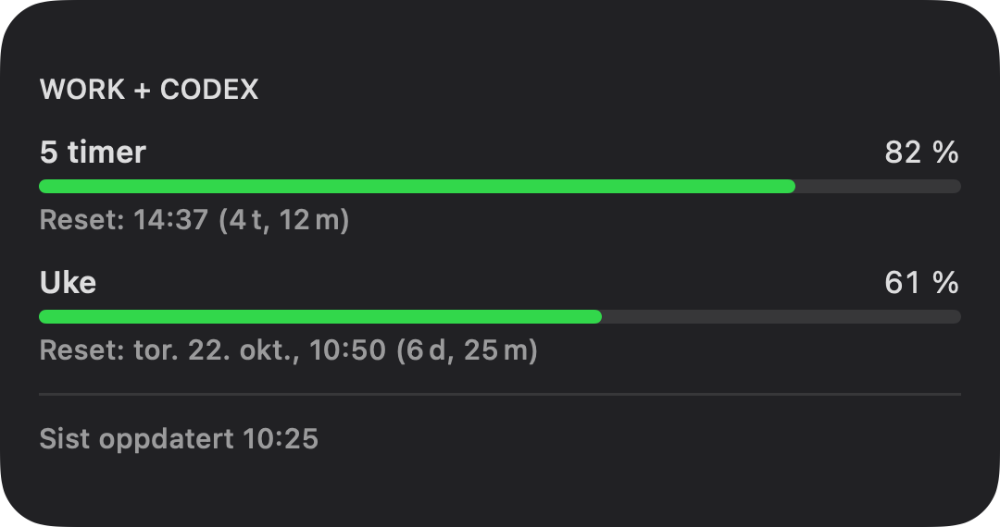
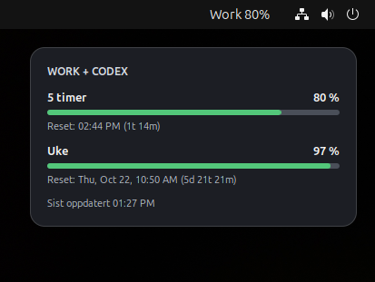

# QuotaMonitor

Read-only Work/Codex quota monitoring for macOS and Ubuntu GNOME.

- **macOS:** a menu-bar app with an embedded WidgetKit desktop widget.
- **Ubuntu 24.04 / GNOME Shell 46:** a desktop quota card and top-bar extension.

Both versions read quota through the locally signed-in Codex CLI using
`codex app-server --listen stdio://` and `account/rateLimits/read`. They do not
start model turns, parse authentication files, scrape ChatGPT, or purchase credits.
Each computer monitors the Codex account signed in on that computer.

## Widget previews

| macOS desktop widget | Ubuntu / GNOME desktop widget |
| --- | --- |
|  |  |

The macOS preview is rendered from the widget source using example values. The
Linux image is an actual Ubuntu 24.04 / GNOME Shell 46 screenshot. Quota values
and reset dates vary with your account. See [image sources](docs/images/README.md).

## Features

- Remaining percentages for the 5-hour (300-minute) and weekly (10080-minute) windows.
- Local reset date/time and countdown, using the `resetsAt` supplied by Codex.
- Green indicators at 50% or above, yellow from 20% to below 50%, red below 20%.
- A menu/top-bar percentage showing the lowest available remaining quota.
- Automatic refresh every 120 seconds and a manual refresh action.
- Last successfully read quotas and reset times retained after a failed refresh,
  with a failure indication and last successful update time.

The interface uses Norwegian labels. Reset dates/times use the system locale and
timezone. GPT Pro chat quotas are not part of the monitor.

## macOS

The working development environment is macOS 15.7.9, Xcode 26.3, and Codex CLI
0.162.1. The deployment target is macOS 14.0.

1. Install Xcode and a compatible Codex CLI, and sign in to Codex on the Mac.
2. Open `QuotaMonitor.xcodeproj` from this source folder.
3. Select the **QuotaMonitor** scheme and **My Mac**, then Build and Run.
4. Use **Oppdater fra Codex nå** in the menu-bar app to check the quota.
5. Add **ChatGPT kvoter** through macOS **Edit Widgets**.

The widget extension is embedded inside `QuotaMonitor.app`; there is no separate
widget installation. Both shared launch schemes start the containing menu-bar app
for desktop testing rather than opening WidgetKit Simulator.

For daily use, quit any running copies and copy the built `QuotaMonitor.app` from
Xcode's Products folder into Applications. Replace the previous version and run
the Applications copy. Edit source files here, not in Xcode's DerivedData folder.
The app includes **Avslutt QuotaMonitor** to quit its menu-bar instance.

The main app starts the local Codex executable, so App Sandbox is disabled for the
main app; the widget remains sandboxed. This is a local-development configuration,
not a notarized/App Store distribution setup. If Xcode requests signing settings,
configure the appropriate team for both targets.

Preserve these working identifiers and widget registration:

| Setting | Value |
| --- | --- |
| Main app bundle ID | `no.joachim.QuotaMonitor` |
| Widget bundle ID | `no.joachim.QuotaMonitor.Widget` |
| Shared App Group | `group.no.hegstad.quotamonitor` |
| `Widget/Info.plist` extension point | `com.apple.widgetkit-extension` |

`project.yml` is the XcodeGen project specification. If it changes, regenerate the
project with XcodeGen before building:

```bash
xcodegen generate
xcodebuild -project QuotaMonitor.xcodeproj -scheme QuotaMonitor -configuration Debug build
```

Codex executable discovery is in `App/CodexReader.swift`. The standard installation
paths include `/usr/local/bin/codex` and `/opt/homebrew/bin/codex`.

WidgetKit controls desktop rendering and refresh scheduling; the desktop widget
can update later than the menu-bar app. Select full-color widget appearance in
macOS settings to keep the quota status colors visible.

## Ubuntu / GNOME

See [Linux installation and troubleshooting](Linux/README.md).

With Codex CLI installed and signed in on Ubuntu, install from a clone with:

```bash
cd Linux
python3 install.py
```

Log out and back in, then enable the extension:

```bash
gnome-extensions enable quotamonitor@hegstad.no
```

For a transferable installation ZIP, run `python3 Linux/package.py`. Generated
packages are excluded from Git; all sources and the packaging script are included.

## Tests

The Linux reader tests use synthetic RPC responses, not a real account:

```bash
PYTHONDONTWRITEBYTECODE=1 python3 -m unittest discover -s Linux/tests -p 'test_*.py' -v
gjs -m Linux/tests/test_display.mjs
glib-compile-schemas --strict --dry-run Linux/extension/schemas
```

On macOS, JavaScriptCore's `jsc -m` can run the pure display tests instead of GJS.
The macOS app/widget build and bundle metadata have been checked locally. The
GNOME version has been shown running on Ubuntu 24.04 / GNOME Shell 46; desktop
behavior after further changes still needs testing on a real GNOME session.

## Publish to GitHub

`publish-github.sh` prepares this source folder as a Git repository and creates a
**private** `JHegstad/QuotaMonitor` repository. Run it in your normal Mac terminal
with GitHub CLI authenticated as `JHegstad`:

```bash
bash publish-github.sh
```

Build outputs, local screenshots, Xcode user state, and generated ZIPs are ignored.
No existing remote repository is overwritten by the publishing script.
